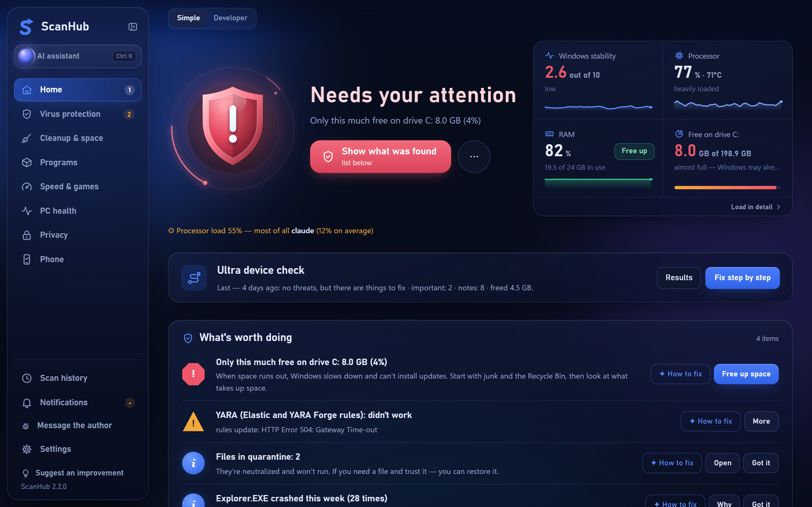
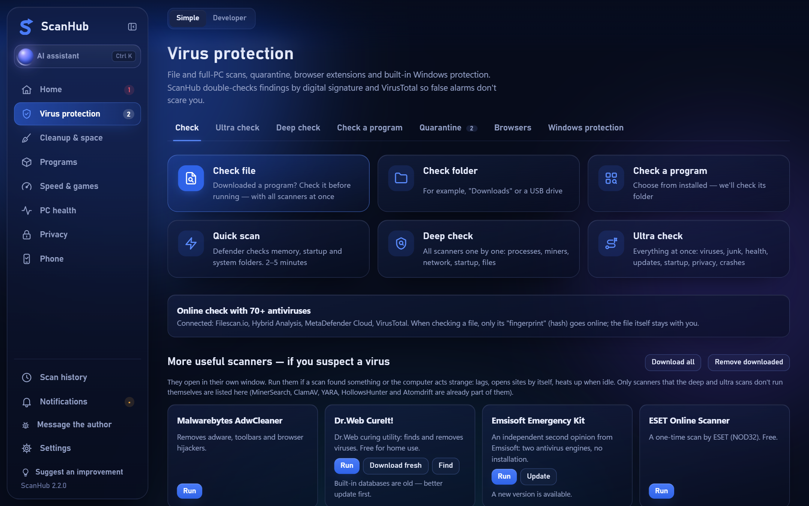
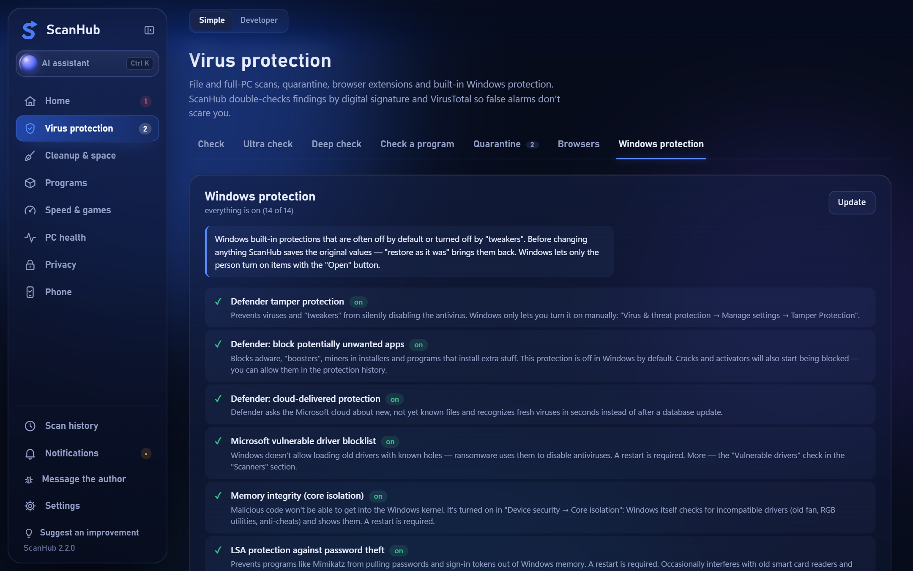
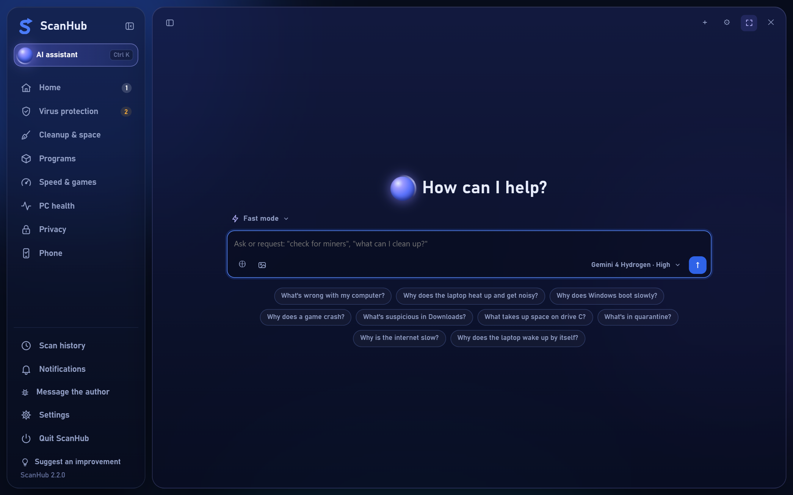
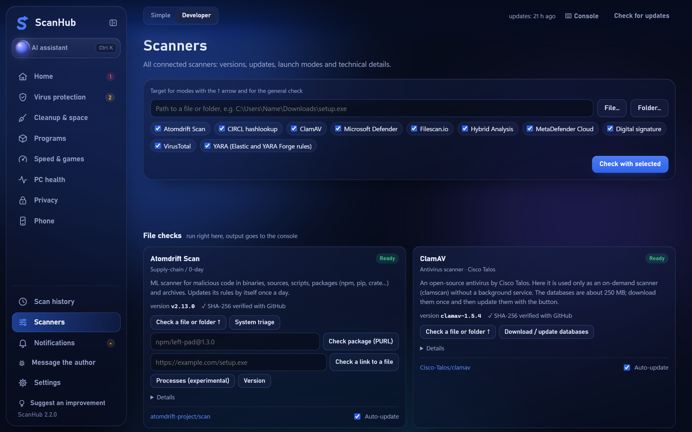

<picture>
  <source media="(prefers-color-scheme: dark)" srcset="docs/logo/scanhub-horizontal-on-dark.svg">
  
</picture>

# ScanHub

[Русская версия](README.ru.md)

Everything you need to check and maintain Windows, in one window: 30+ antivirus engines, scanners and checks, cleanup, programs, privacy and protection. **One-off** checks only: ScanHub keeps nothing running in the background and installs no permanent services.

  · Windows 10/11 · free, open source (MIT)

⭐ Found ScanHub useful? Give it a star (the **Star** button at the top of this page) so others can find it more easily.

### ⬇ [Download ScanHub for Windows](../../releases/latest/download/ScanHub-Windows.zip)

Unpack the archive into any folder and run **ScanHub.exe**. Nothing to install, Python is already inside.

Every release also has **SHA256SUMS.txt** with the checksums of both archives, so you can check that the download wasn't altered.

| Virus protection: file, folder, quick, deep and ultra checks | Built-in Windows protections with an undo |
|---|---|
|  |  |

## What it does

- **A home screen you can read in a second (2.0):** a live shield shows the real state: “all good”, “something to fix” or “threat found”. During a scan a beam runs across it and the ring fills up with the percentage. Next to it: Windows stability, CPU, memory and free space with charts; click one to see detailed load. Below that, “What's worth doing” and quick actions.
- **Its own window (2.0.5):** ScanHub opens in a dedicated window with no browser chrome. The window buttons sit in its dark header, and its size and position are remembered. If the WebView2 engine is missing (Windows 10), it opens through Edge instead.
- **Final AI verdict (2.0.9):** after a file scan, a deep check or an ultra check, the built-in AI agent reads the combined result of all scanners, searches the web for the file (name, SHA-256, what people write about it, with links) and gives a short answer: “Safe to open” or “Don't open it”. Under the verdict there is a chat: ask what the file is, what to do next, or tell the agent to do it for you.
- **AI second opinion:** “Copy summary for AI” after a file scan (signature, hashes, where it was downloaded from, every scanner with details), after an ultra check, plus “Full PC summary for AI” (28 sections about the whole PC). Paste it into Claude, ChatGPT or Gemini and you get a short answer (“dangerous or not, and what to do” in a few words) and a detailed one with facts. Personal data is hidden by default.
- **One-click RAM cleanup** right on the home screen, like Mem Reduct.
- **Deeper junk cleanup (2.3.0):** browser and app caches (including Brave, Vivaldi, Slack and the GPU caches inside browsers), blue-screen memory dumps, Windows.old in one click, plus old installers and long-unopened big files in Downloads and Steam games you haven't played for two months (to the Recycle Bin / through Steam, nothing ticked in advance). It never follows links and can't touch your personal folders.
- **Sections by task:** “Virus protection”, “Cleanup & space”, “Programs”, “Speed & games”, “PC health”, “Privacy”, “Phone”. Everything is grouped by what you want to do, not by how the program is built.
- **Virus scanning.** A file or folder goes through several engines at once (Microsoft Defender, ClamAV, YARA, Atomdrift, digital signature, online hash lookup) and gets one overall verdict: “safe to run / better not to run”. The verdict filters out false alarms: long-known legitimate files (the NIST NSRL database, the Hybrid Analysis allowlist, years on VirusTotal with a good reputation) do not turn “dangerous” because of one or two detections. There is also a deep and an “ultra” scan of the whole system, and a fix wizard.
- **Extra antivirus engines run by themselves:** at the end of the ultra check, Kaspersky VRT, Microsoft Safety Scanner, AdwCleaner, Emsisoft and Dr.Web CureIt! scan all drives one after another in the background (detection only; cleaning happens on a button press), while ESET and Malwarebytes open in their own windows and ScanHub clicks “Start” itself. After the scan you can remove the scanners together with their traces.
- **Third-party scanners** in one click: Kaspersky VRT, Dr.Web CureIt!, ESET, Emsisoft, Malwarebytes, AdwCleaner, MinerSearch, Microsoft Safety Scanner, HollowsHunter, Autoruns, HiJackThis+ and others. They are downloaded from the official sites, with signature and checksum verification.
- **Finding threats antivirus engines miss:** connections to malware servers (Maltrail lists), programs from fake sites (FMHY), vulnerable drivers (LOLDrivers), malicious browser extensions (MalExt), forged root certificates (Sigcheck), leaked keys in projects (TruffleHog), malicious npm/pip packages (OSV).
- **Windows protection:** checks and enables the built-in protections (tamper protection, memory integrity, LSA, SmartScreen, driver blocklist…), privacy, firewall, startup. All with an undo.
- **Check before you run:** right-click a file or folder → “Check in ScanHub” (turn it on in ⚙ Settings).
- **Health history:** battery wear over the years, disk space, stability index and crashes by day, with trends (“the battery loses 0.4% a month”, “the disk will fill up in …”).
- **Maintenance:** junk cleanup with explanations, disk usage, duplicates, program removal with leftovers, program updates and startup, PC health and crashes, system load.
- **Phone check** (Android over a cable, via USB debugging): stalkerware apps (the stalkerware-indicators database), apps not from a store (checked on VirusTotal by hash), who has special permissions, device admin rights and notification access, root and an unlocked bootloader, security patch age, battery and memory. Nothing is installed on the phone; removing an app or revoking its access happens only on a button press.
- **Devices** (PC health → Devices): keyboard, mouse and touchpad, microphone, audio, camera, Bluetooth. Whether they work and why not; live tests right in the window (microphone level and a 3-second recording, all keys and key chatter, mouse buttons, spontaneous double clicks and polling rate, left/right audio, camera picture); who recently turned on the microphone and camera.
- **“Why is my internet slow”** (Speed & games → Internet): ping to the router and to the internet, packet loss, DNS, Wi‑Fi, VPN and speed, with a plain verdict on where exactly the problem is.
- **Ultra check report as PDF** and a comparison with the previous check: what was fixed and what is new.
- **“What ScanHub changed”** (Privacy → What ScanHub changed): every system change in one list, with a date and an “Undo” button: settings, startup, firewall, PATH, removed program entries.
- **One-button update:** when a new version comes out, an “Update” button appears on the home screen. ScanHub downloads it from here, verifies the checksum and installs it over the old one; your keys and history stay.
- **Glass interface with smooth motion (2.2):** the menu collapses into a strip of icons, load numbers roll smoothly to new values; with animations turned off in Windows there's no motion.
- **Russian and English interface:** the switch is at the very top of ⚙ Settings.
- **Built-in AI agent (optional):** the first item of the side menu (“AI agent”); **Ctrl+K** opens it from any page. The “✦ How to fix” button on any finding (short: the cause, the steps, and a button for an automatic fix if ScanHub can do it itself, with confirmation) and the “Ask about your PC” chat: the agent inspects Windows logs, crashes, sensors, disk space, protection, browsers, quarantine and, if you allow it, files and folders; it can also run safe read-only scans (miner search, Defender quick scan, junk check, startup, PC health, hardware) right from the chat and answer from the results. It never changes system settings on its own — it only reads, runs checks, and proposes fixes. If ScanHub can fix the problem itself, the answer gets action buttons and **“✦ Do it for me”**: the agent runs just those approved actions one by one and verifies the result, through the same checks and UAC prompts as ScanHub buttons, with an entry in “What ScanHub changed”. Pick your model: free Gemini; **Claude, ChatGPT or Gemini through your own subscription** (ScanHub launches the official Claude Code, Codex or Antigravity from Google that you are already signed in to; in Antigravity you can choose the model, Gemini Hydrogen, Argon, Flash and others from your subscription, and the thinking level from Low to XHigh; requests count against your subscription limits; the agent has no command line, it gets data through ScanHub's tools and may search the web for references, which you can turn off in the agent settings); by API key: Claude, OpenAI, OpenRouter, DeepSeek; or local Ollama.
- **Chat history and agent memory (2.4):** every conversation with the agent is saved on this computer — in full-window mode as a list on the left, like in chat apps (search, pin, rename, delete), in the side panel behind the “History” button. The agent names chats itself. It remembers important things between conversations (what computer you have, what was already fixed, what you asked it to remember); you can see and delete these notes in its settings and turn memory off there. The agent can also search past conversations, check printers and the print queue, Windows services and Task Scheduler tasks, knows today's date, writes scripts in code blocks with a “Copy” button, and no longer gives up when a free key hits its rate limit: it waits a few seconds or answers through another model of the same service. While the agent works you see a live scene matching the step (a radar for miners, a beam over files, network waves, scrolling logs, a globe), the elapsed time and the step number; a long check through a subscription isn't cut off while the agent keeps making steps.

## Installation

1. Windows 10 or 11, 64-bit.
2. Download **[ScanHub-Windows.zip](../../releases/latest/download/ScanHub-Windows.zip)** (about 32 MB) and unpack it into any folder, for example `D:\ScanHub`.
3. Run **ScanHub.exe**. ScanHub opens in its own dedicated window (or Microsoft Edge if WebView2 isn't available). The home screen has a “Create shortcut” button for the desktop and the Start menu.
4. On the home screen click **“Prepare”**. ScanHub downloads the missing scanners and their databases from the official sites (about 1 GB, 5–15 minutes, once). Without this only Defender and the signature check work.

**If Windows says “Windows protected your PC”.** ScanHub.exe has no digital signature (it costs money; open source projects can get one for free through the SignPath Foundation, which is planned), so SmartScreen warns about any new program. Click **“More info” → “Run anyway”**; you only need to do it once. ScanHub.exe is a tiny launcher: its source is in [`launcher/ScanHub.cs`](launcher/ScanHub.cs), and all it does is open `scanhub.py` with the bundled Python.

The archive contains the official Python build from python.org (signed by the Python Software Foundation) and the psutil and yara-x packages.

**If you already have Python 3.12 or newer**, you can take the source code (**Code → Download ZIP**), run `pip install -r requirements.txt` in the folder and start **ScanHub.exe**. It finds the installed Python by itself.

Optional:
- **7-Zip**: needed only for Emsisoft Emergency Kit.
- **Free API keys** for VirusTotal, Filescan, MetaDefender, Hybrid Analysis (⚙ Settings) for online lookups against dozens of antivirus engines. Everything else works without keys.

## What goes to the internet

| What | Where | When |
|---|---|---|
| The hash (fingerprint) of the file being checked, not the file itself | VirusTotal, Filescan, MetaDefender, Hybrid Analysis, CIRCL | when you scan a file; the first four only if you entered a key |
| The file itself | VirusTotal or Filescan | only with the separate “Upload the file for analysis” button, with a warning |
| Names and versions of npm/pip packages | OSV.dev (Google) | only in the “npm and pip packages” check |
| A found API key (to check whether it is still active) | the service that key belongs to | only in the TruffleHog “Only active keys” mode |
| The data the AI agent looks at (logs, file details; contents of text files only if you allowed it), without your user name, computer name, email and keys | the service you chose: Google Gemini, Anthropic (Claude), OpenAI (ChatGPT), OpenRouter or DeepSeek, directly or through Claude Code / Codex / Antigravity | only if you picked a cloud model and asked a question; with Ollama nothing leaves your PC |
| Update requests | GitHub and the scanners' official sites | update checks and database downloads |
| Nothing about the phone, only tool downloads: Google Platform Tools (if adb is not installed yet) and the list of stalkerware apps | dl.google.com, GitHub | during a phone check; hashes of apps not from a store go to VirusTotal if you entered a key |
| An anonymous “ScanHub ran today” ping: random copy id, version, language, Windows build number | the ScanHub author (Cloudflare Worker) | once a day, **only if you agreed** (card on the home screen or ⚙ Settings) |
| An error report or an idea: only what you saw in the window before sending; the ScanHub error log only if you tick the box | the ScanHub author on Telegram (through a Cloudflare Worker) | on “Bug or idea?” → “Send” |
| The ids of your messages to the author and the secrets for them, to fetch the author's reply | the ScanHub author (Cloudflare Worker) | every half hour while ScanHub is open, and only if you wrote to the author |
| The AI agent's search queries (a program name, an error code; no paths or user name) and the pages it reads | DuckDuckGo or Bing, sites from the results; the winget catalog | only if internet access is enabled in the agent settings and the agent needs a reference |

ScanHub sends nothing else anywhere: no ads, no accounts, no hidden analytics. The launch counter works only if you agreed to it, and an error report goes out only when you press “Send”. History, logs and settings are stored only on your computer, in the `data` folder (API keys are encrypted by Windows for your account). To clear history and logs: ⚙ Settings → “Clear scan history and logs”.

## Uninstalling

⚙ Settings → **“Remove ScanHub from this computer…”**. ScanHub removes everything it added outside its own folder (the right-click menu entry, shortcuts, Task Scheduler tasks, the block in the hosts file, folders in Program Files and ProgramData) and, if you want, deletes the folder itself. Changes to Windows settings stay; you can undo them beforehand in “Privacy → What ScanHub changed”. You can also just delete the folder, but then the menu entry and the scheduled tasks stay behind.

## Administrator rights

The UAC prompt appears only when it is really needed: deep process scanning, system folders during cleanup, changes to Windows settings, third-party scanners that do not work without admin rights. Before any system change ScanHub saves the original values and offers a restore point.

**Ultra check: one UAC prompt for the whole scan (2.0.7).** At the very start it asks for admin rights once and launches a helper that lives only until the scan ends (and until the program updates at its end). The helper does only what the ultra check itself does: removing old drivers, checking system files and disks, the restore point, cleaning system folders from the junk catalog, updating through winget, the scanners from the ScanHub folder and their reports. Every job is signed with a key that only ScanHub and the helper know; it will not run anything else. When the scan finishes or ScanHub is closed, the helper exits on its own and closes everything it started.

## Security

- The ScanHub server listens only on `127.0.0.1` and answers only its own window: a random token is created on every launch and stored nowhere, and requests from other sites and address spoofing (DNS rebinding) are rejected.
- Only what a scan found can be deleted or quarantined; the shredder works only on what you pick by hand. The window loads nothing from the internet.
- Third-party programs are installed only from official sources: a checksum from GitHub or the publisher's digital signature, plus a VirusTotal lookup (if you have a key). A suspicious new version is held back.
- **Known limitation.** ScanHub is portable, so its folder is writable by your account. Malware that is *already* running on the PC without admin rights could in theory replace ScanHub files and wait for you to confirm UAC. Don't keep ScanHub in shared folders and don't run copies that did not come from this repository.

Found a vulnerability? Write in Issues (without exploitation details) or contact the author directly.

## Important

ScanHub is not a replacement for a permanent antivirus. It helps you double-check your computer and figure out what is going on with it. Findings are a reason to look closer, not a verdict: heuristics produce false positives, and the scan result explains that. System changes are reversible, but you make them at your own risk.

To add your own scanner, write one JSON file in the `registry` folder; the schema is in [registry/README.md](registry/README.md).

## For developers

The tools are in the [`dev`](dev) folder: `selftest.py` (opens every section in headless Edge and catches errors; `--en` does the same in English), `test_server.py` (a copy of the server on port 8799), `make_release.py` and `make_portable.py` (release archives). Translation goes through `i18n_extract.py` → `i18n_batch.py keys` → `i18n_build.py --todo` (translations live in `dev/i18n/*.tsv`). See [CHANGELOG.md](CHANGELOG.md) for what changed.

## Licenses

For the ScanHub code, see [LICENSE](LICENSE). ScanHub does not distribute third-party programs, databases or services: they are downloaded or called on your computer from official sources and keep their own licenses. The list is in [THIRD_PARTY_NOTICES.md](THIRD_PARTY_NOTICES.md).
