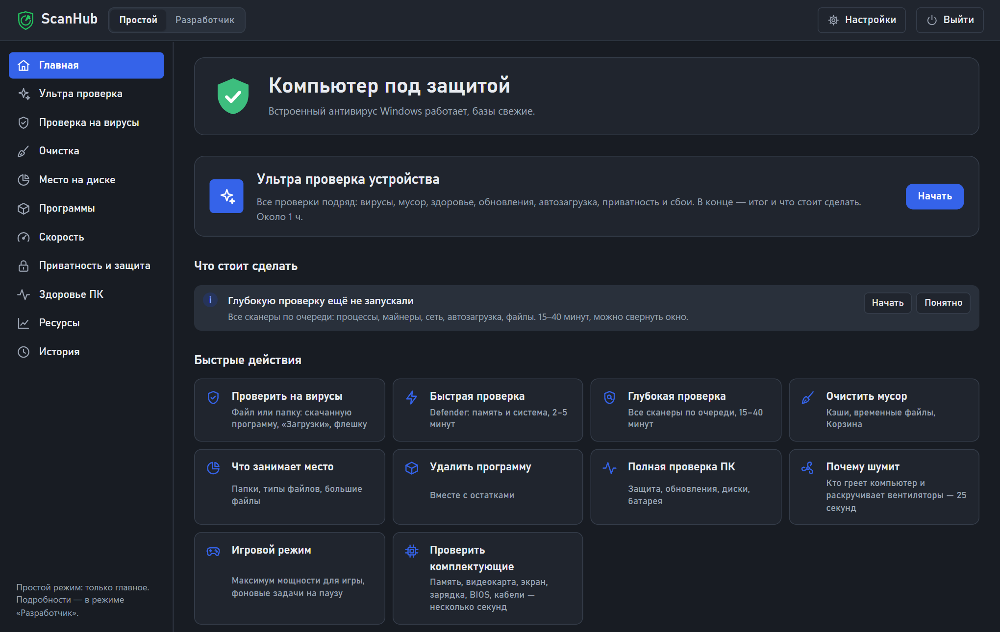
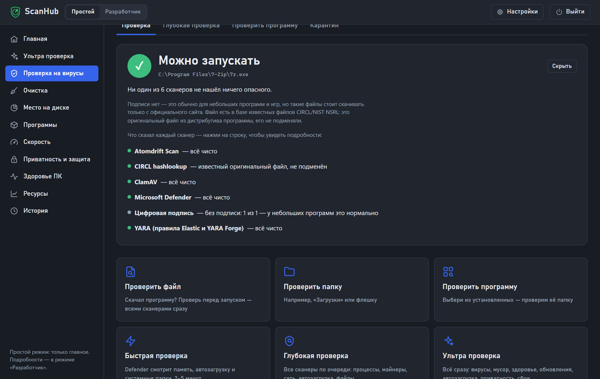
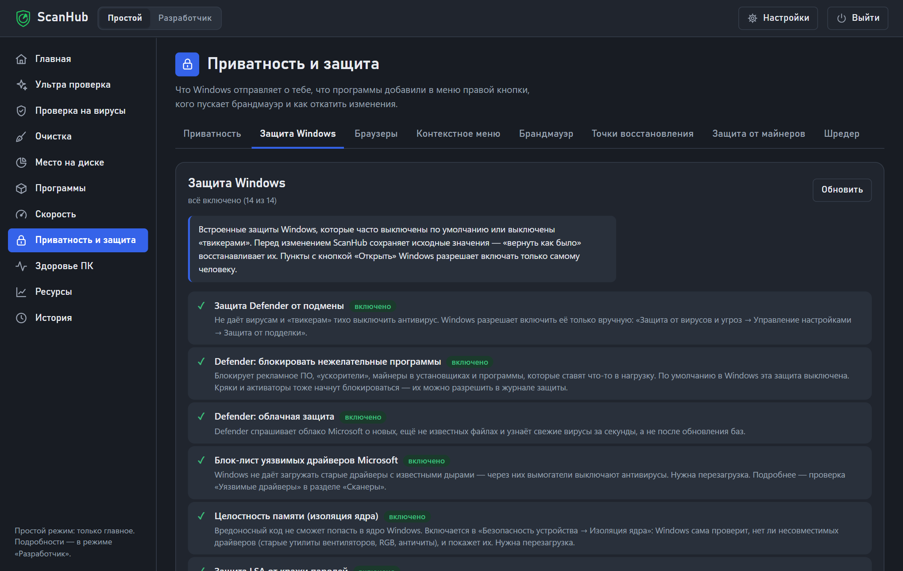
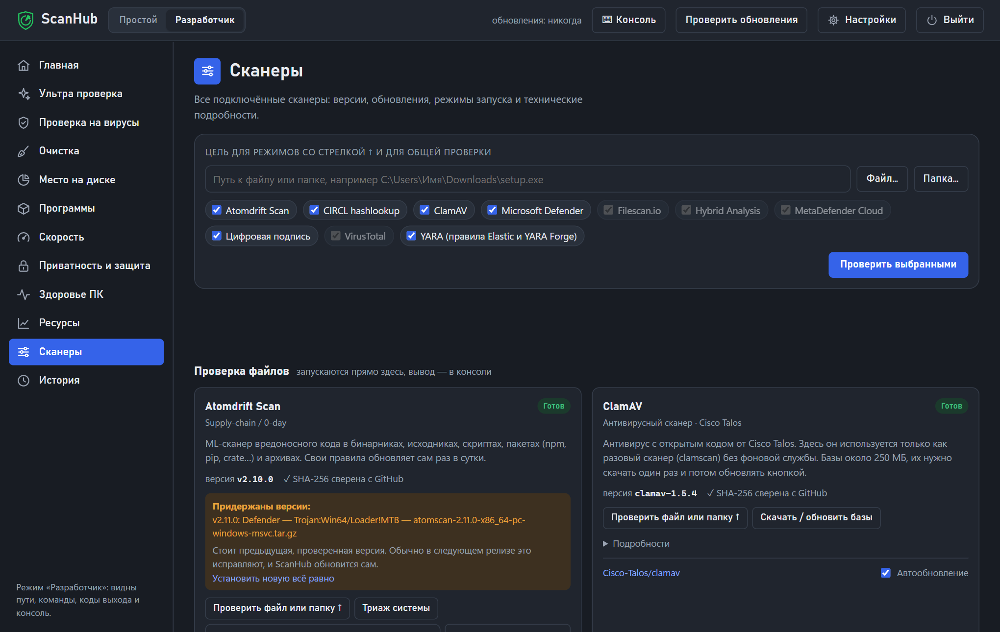

# ScanHub

*[English summary below](#english)*

Всё для проверки и обслуживания Windows в одном окне: 30+ антивирусов, сканеров и проверок, очистка, программы, приватность и защита. Только **разовые** проверки: ScanHub ничего не держит запущенным в фоне и не ставит постоянных служб.

Версия 1.0.0 · Windows 10/11 · бесплатно, открытый код (MIT)

### ⬇ [Скачать ScanHub для Windows](../../releases/latest/download/ScanHub-Windows.zip)

Распакуй архив в любую папку и запусти **ScanHub.exe** — устанавливать ничего не нужно, Python уже внутри.

| Проверка файла: несколько антивирусов и общий итог | Встроенные защиты Windows с «вернуть как было» |
|---|---|
|  |  |

## Что умеет

- **Проверка на вирусы.** Файл или папка проверяются сразу несколькими движками (Microsoft Defender, ClamAV, YARA, Atomdrift, цифровая подпись, онлайн-сверка по хэшу) с общим итогом «можно запускать / лучше не запускать». Глубокая и «ультра» проверка всей системы, мастер исправлений.
- **Сторонние сканеры** в один клик: Kaspersky VRT, Dr.Web CureIt!, ESET, Emsisoft, Malwarebytes, AdwCleaner, MinerSearch, Microsoft Safety Scanner, HollowsHunter, Autoruns, HiJackThis+ и другие. Скачиваются с официальных сайтов с проверкой подписи и контрольной суммы.
- **Поиск угроз, которых не видят антивирусы:** соединения с серверами вирусов (базы Maltrail), программы с поддельных сайтов (FMHY), уязвимые драйверы (LOLDrivers), вредоносные расширения браузеров (MalExt), поддельные корневые сертификаты (Sigcheck), утёкшие ключи в проектах (TruffleHog), вредоносные пакеты npm/pip (OSV).
- **Защита Windows:** проверка и включение встроенных защит (защита от подмены, целостность памяти, LSA, SmartScreen, блок-лист драйверов…), приватность, брандмауэр, автозагрузка — всё с «вернуть как было».
- **Проверка до запуска:** правая кнопка по файлу или папке → «Проверить в ScanHub» (включается в ⚙ Настройках).
- **История здоровья:** износ батареи за годы, место на дисках, индекс стабильности и сбои по дням — с трендами («батарея теряет 0,4% в месяц», «диск заполнится через …»).
- **Обслуживание:** очистка мусора с объяснениями, место на диске, дубликаты, удаление программ с остатками, обновление программ, здоровье ПК и сбои, ресурсы.
- **Проверка телефона** (Android по кабелю, через отладку по USB): приложения-следилки (база stalkerware-indicators), приложения не из магазина (с проверкой в VirusTotal по хэшу), кто получил спец. возможности, права администратора и доступ к уведомлениям, root и разблокированный загрузчик, давность обновлений безопасности, батарея и память. На телефон ничего не ставится; удалить приложение или снять с него доступ — только по кнопке.
- **Устройства** (Здоровье ПК → Устройства): клавиатура, мышь и тачпад, микрофон, звук, камера, Bluetooth — работают ли и почему нет; живые проверки прямо в окне (уровень микрофона и запись на 3 секунды, все клавиши и «дребезг», кнопки мыши, двойной щелчок сам по себе и частота опроса, звук слева/справа, картинка с камеры); кто недавно включал микрофон и камеру.
- **«Почему тормозит интернет»** (Скорость → Интернет): пинг до роутера и в интернет, потери, DNS, Wi‑Fi, VPN и скорость — с понятным выводом, где именно проблема.
- **Отчёт ультра проверки в PDF** и сравнение с прошлой проверкой: что исправлено, что появилось нового.
- **«Что изменил ScanHub»** (Приватность и защита): все изменения системы списком, с датой и кнопкой «Отменить» — настройки, автозагрузка, брандмауэр, PATH, удалённые записи программ.
- **Обновление в одну кнопку:** когда выходит новая версия, на главной появляется «Обновить» — ScanHub скачает её отсюда, сверит контрольную сумму и поставит поверх, ключи и история останутся.
- **Русский и английский интерфейс** — переключатель внизу боковой панели (*English interface: switch at the bottom of the sidebar*).
- **ИИ-помощник (по желанию).** Кнопка «✦ Как решить» у любой находки (коротко: причина, шаги и кнопка автоматического решения, если ScanHub может сделать это сам — с подтверждением) и чат «Спроси про свой ПК»: помощник сам смотрит журналы Windows, сбои, датчики, место, защиту, браузеры, карантин и — если разрешишь — файлы и папки. Сам он ничего не меняет — только читает и советует. Если ScanHub может исправить проблему сам, у ответа появятся кнопки действий и **«✦ Сделай сам»**: помощник выполнит только эти действия по очереди и проверит результат — через те же проверки и окна UAC, что и кнопки ScanHub, с записью в «Что изменил ScanHub». Модель на выбор: бесплатный Gemini; **Claude или ChatGPT по своей подписке** (ScanHub запускает официальные Claude Code или Codex, в которые ты вошёл, — запросы идут в лимиты подписки; у агента нет командной строки — данные он берёт инструментами ScanHub, а справки может искать в интернете, это выключается в настройках помощника); по ключу API — Claude, OpenAI, OpenRouter, DeepSeek; или локально Ollama.

## Установка

1. Windows 10 или 11, 64-бит.
2. Скачай **[ScanHub-Windows.zip](../../releases/latest/download/ScanHub-Windows.zip)** (около 26 МБ) и распакуй в любую папку, например `D:\ScanHub`.
3. Запусти **ScanHub.exe**. Окно откроется в Microsoft Edge (режим приложения). На главной будет кнопка «Создать ярлык» — для рабочего стола и «Пуска».
4. На главной нажми **«Подготовить»** — ScanHub сам скачает с официальных сайтов недостающие сканеры и их базы (около 1 ГБ, 5–15 минут, один раз). Без этого работают только Defender и проверка подписи.

**Если Windows пишет «Windows защитила ваш компьютер».** У ScanHub.exe нет цифровой подписи (она платная; для открытых проектов бывает бесплатная — через SignPath Foundation, это планируется), поэтому SmartScreen предупреждает о любой новой программе. Нажми **«Подробнее» → «Выполнить в любом случае»** — это нужно один раз. ScanHub.exe — маленькая запускалка: её исходный код в [`launcher/ScanHub.cs`](launcher/ScanHub.cs), она только открывает `scanhub.py` встроенным Python.

Внутри архива — официальная сборка Python с python.org (подписана Python Software Foundation) и пакеты psutil и yara-x.

**Если у тебя уже стоит Python 3.14+**, можно взять исходный код (**Code → Download ZIP**), в папке выполнить `pip install -r requirements.txt` и запустить **ScanHub.exe** — он найдёт установленный Python сам.

Необязательно:
- **7-Zip** — нужен только для Emsisoft Emergency Kit.
- **Бесплатные ключи API** VirusTotal, Filescan, MetaDefender, Hybrid Analysis (⚙ Настройки) — для онлайн-сверки с десятками антивирусов. Без ключей всё остальное работает.

## Что уходит в интернет

| Что | Куда | Когда |
|---|---|---|
| Хэш (отпечаток) проверяемого файла — сам файл нет | VirusTotal, Filescan, MetaDefender, Hybrid Analysis, CIRCL | при проверке файла; первые четыре — только если ты ввёл ключ |
| Сам файл | VirusTotal или Filescan | только по отдельной кнопке «Загрузить файл» с предупреждением |
| Названия и версии пакетов npm/pip | OSV.dev (Google) | только в проверке «Пакеты npm и pip» |
| Найденный ключ API (для проверки, действует ли он) | сервис этого ключа | только в режиме TruffleHog «Только действующие ключи» |
| Данные, которые смотрит ИИ-помощник (журналы, сведения о файлах; содержимое текстовых файлов — только если ты это разрешил) — без имени пользователя, имени компьютера, почты и ключей | выбранный сервис: Google Gemini, Anthropic (Claude), OpenAI (ChatGPT), OpenRouter или DeepSeek — напрямую или через Claude Code / Codex | только если ты выбрал облачную модель и задал вопрос; с Ollama ничего не уходит |
| Запросы обновлений | GitHub и официальные сайты сканеров | проверка обновлений и скачивание баз |
| Ничего о телефоне — только загрузка инструментов: Google Platform Tools (если adb ещё не стоит) и список приложений-следилок | dl.google.com, GitHub | при проверке телефона; хэши приложений не из магазина — в VirusTotal, если ты ввёл ключ |
| Анонимная отметка «ScanHub запущен сегодня»: случайный номер копии, версия, язык, номер сборки Windows | автору ScanHub (Cloudflare Worker) | раз в день, **только если ты согласился** (карточка на главной или ⚙ Настройки) |
| Сообщение об ошибке или идея — только то, что ты увидел в окне перед отправкой; журнал ошибок ScanHub — по галочке | автору ScanHub в Telegram (через Cloudflare Worker) | по кнопке «Ошибка или идея?» → «Отправить» |
| Номера твоих сообщений автору и секреты к ним — чтобы забрать его ответ | автору ScanHub (Cloudflare Worker) | раз в полчаса, пока ScanHub открыт, и только если ты писал автору |
| Поисковые запросы помощника (название программы, код ошибки — без путей и имени) и страницы, которые он читает | DuckDuckGo или Bing, сайты из результатов; каталог winget | только если в настройках помощника включён интернет и помощнику нужна справка |

Больше ScanHub ничего никуда не отправляет: нет рекламы, аккаунтов и скрытой аналитики. Счётчик запусков работает, только если ты сам на него согласился, а отчёт об ошибке уходит, только когда ты сам нажмёшь «Отправить». История, журналы и настройки хранятся только на твоём компьютере в папке `data` (ключи API — зашифрованы Windows для твоей учётной записи). Очистить историю и журналы: ⚙ Настройки → «Очистить историю проверок и журналы».

## Удаление

⚙ Настройки → **«Удалить ScanHub с компьютера…»**. ScanHub уберёт всё, что добавлял вне своей папки (пункт в меню правой кнопки, ярлыки, задачи планировщика, блокировку в файле hosts, папки в Program Files и ProgramData), и по желанию удалит саму папку. Изменения настроек Windows останутся — их можно заранее отменить в «Приватность и защита → Что изменил ScanHub». Просто удалить папку тоже можно, но тогда пункт меню и задачи планировщика останутся.

## Права администратора

Окно UAC появляется только когда это действительно нужно: глубокая проверка процессов, системные папки при очистке, изменение настроек Windows, сторонние сканеры, которые без прав не работают. Перед любым изменением системы ScanHub сохраняет исходные значения и предлагает точку восстановления.

## Безопасность

- Сервер ScanHub слушает только `127.0.0.1` и отвечает только своему окну: случайный токен создаётся заново при каждом запуске и нигде не хранится, запросы с чужих сайтов и подмена адреса (DNS rebinding) отклоняются.
- Удалять и убирать в карантин можно только то, что нашла проверка; шредер — только выбранное вручную. Окно не загружает ничего из интернета.
- Сторонние программы ставятся только с официальных источников: контрольная сумма с GitHub или цифровая подпись издателя, плюс сверка с VirusTotal (если есть ключ) — подозрительная новая версия «придерживается».
- **Известное ограничение.** ScanHub портативный, поэтому его папка доступна на запись твоей учётной записи. Вредонос, который *уже* работает на ПК без прав администратора, теоретически может подменить файлы ScanHub и дождаться, когда ты подтвердишь UAC. Не держи ScanHub в общих папках и не запускай копии, полученные не из этого репозитория.

Нашёл уязвимость — напиши в Issues (без подробностей эксплуатации) или автору напрямую.

## Важно

ScanHub не заменяет постоянный антивирус — он помогает перепроверить компьютер и разобраться, что с ним. Находки — повод проверить, а не приговор: у эвристик бывают ложные срабатывания, итог проверки это объясняет. Изменения системы обратимы, но ты делаешь их на свой риск.

Добавить свой сканер — один JSON-файл в папке `registry`, схема в [registry/README.md](registry/README.md).

## Для разработчиков

Инструменты — в папке [`dev`](dev): `selftest.py` (открывает все разделы в Edge без окна и ловит ошибки, `--en` — то же на английском), `test_server.py` (копия сервера на порту 8799), `make_release.py` и `make_portable.py` (архивы для выпуска), перевод — `i18n_extract.py` → `i18n_batch.py keys` → `i18n_build.py --todo` (переводы в `dev/i18n/*.tsv`). Что менялось — в [CHANGELOG.md](CHANGELOG.md).

## Лицензии

Код ScanHub — см. [LICENSE](LICENSE). Сторонние программы, базы и сервисы ScanHub не распространяет: они скачиваются или вызываются на твоём компьютере с официальных источников и остаются под своими лицензиями — список в [THIRD_PARTY_NOTICES.md](THIRD_PARTY_NOTICES.md).

## English

**ScanHub** is a free, open-source toolbox for checking and maintaining a Windows 10/11 PC in one window: 30+ antivirus scanners and checks (Microsoft Defender, ClamAV, YARA, Kaspersky VRT, Dr.Web CureIt!, ESET, Malwarebytes, AdwCleaner, HiJackThis+…), junk cleanup, disk usage, program uninstall with leftovers, privacy and Windows security settings with one-click undo, crash and stability analysis, an internet-slowdown diagnosis and an optional AI assistant. Everything is **one-off**: nothing keeps running in the background.

- **Install:** download [ScanHub-Windows.zip](../../releases/latest/download/ScanHub-Windows.zip), unpack anywhere, run `ScanHub.exe` (Python is bundled). SmartScreen may warn because the launcher is not code-signed — "More info" → "Run anyway".
- **Language:** the interface is Russian by default; switch to English at the bottom of the left sidebar. The AI assistant then answers in English too.
- **Phone check:** Android over USB debugging — stalkerware, apps not from a store (checked on VirusTotal by hash), who has accessibility/device-admin/notification access, root, patch age, battery. Nothing is installed on the phone.
- **Devices:** keyboard, mouse, microphone, speakers, camera, Bluetooth — status plus live tests in the window (mic level and playback, key tester with chatter detection, mouse buttons/double-click/polling rate).
- **Privacy:** only file hashes go to online scanners (VirusTotal etc., with your own API keys); files are uploaded only when you press "Upload". No ads or accounts; an anonymous daily "ScanHub is running" counter (random copy id, version, language) is sent only if you opt in. Settings and history stay in the `data` folder on your PC.
- **Undo:** "Privacy & protection → What ScanHub changed" lists every change with an Undo button. Settings → "Remove ScanHub from this computer" removes everything ScanHub added outside its folder.
- **License:** MIT (see [LICENSE](LICENSE)); third-party tools are downloaded from their official sources and keep their own licenses ([THIRD_PARTY_NOTICES.md](THIRD_PARTY_NOTICES.md)).
